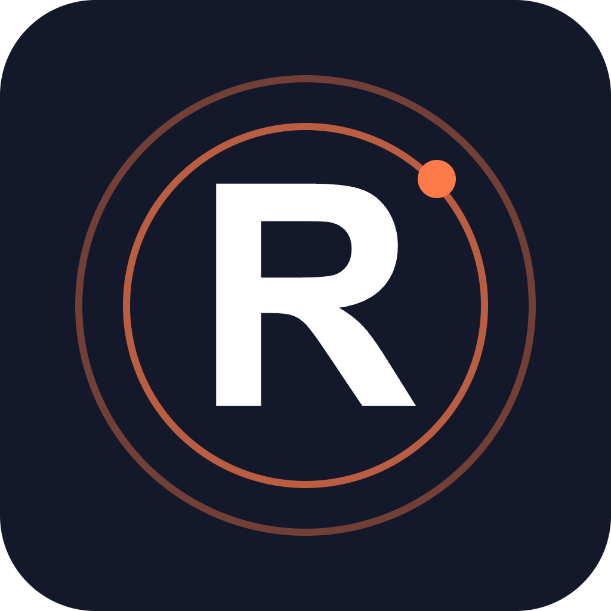

# RugRadar


AI-powered rug pull detection and pump potential scoring for Solana tokens.

## Overview

RugRadar is a dashboard that analyzes newly launched Solana tokens using on-chain data. It scores each token for rug pull risk and price upside potential, helping traders make faster, more informed decisions.

## Problem

Many new tokens on Solana turn out to be rug pulls. Traders don't have time to manually inspect liquidity locks, holder distribution, and contract permissions before deciding whether to buy, and this leads to frequent, avoidable losses.

## Solution

RugRadar automatically collects on-chain data for new tokens and uses a machine learning model to compute two scores: a rug pull risk score and a pump potential score. Everything is presented on a single, easy-to-read dashboard.

## Features (MVP)

- Real-time scanning of new tokens with risk score display
- Automatic checks for liquidity lock status, holder concentration, and contract authority
- Pump potential prediction model trained on historical price patterns
- Alert notifications for dangerous tokens via Discord/Telegram
- Token comparison view for quick risk/reward evaluation

## Tech Stack

- Solana RPC / Geyser for on-chain data streaming
- Helius API for enriched token and wallet data
- Python for data processing and ML pipeline
- scikit-learn / XGBoost for scoring models
- PostgreSQL for data storage
- React for the dashboard frontend
- Discord Webhook for alerting

## How It Works

```
[Solana RPC/Geyser + Helius API]
            |
            v
   [Python data pipeline]
            |
            v
 [PostgreSQL token database]
            |
            v
 [ML model: risk & pump score]
            |
     -------------------
     |                 |
     v                 v
[React dashboard]  [Discord/Telegram alerts]
```

1. New token events are streamed from Solana RPC/Geyser and Helius API.
2. The Python pipeline extracts liquidity lock status, holder distribution, and contract authority.
3. Data is stored in PostgreSQL and fed into an XGBoost model trained on historical price patterns.
4. The model outputs a rug risk score and a pump potential score per token.
5. Scores are shown on the React dashboard and pushed as alerts via Discord/Telegram when risk is high.

## Roadmap

- Expand the training dataset and improve model accuracy
- Add wallet analysis to detect repeat-offender scam wallets
- Launch a paid API tier and a Telegram bot

## Pitch

See our one-minute pitch: [docs/pitch.pdf](docs/pitch.pdf) and the spoken script at [docs/pitch-script.md](docs/pitch-script.md).

## Team

- [Your Name] - Role (e.g. Full-stack / ML)
- [Teammate Name] - Role
- [Teammate Name] - Role

Built for the Colosseum hackathon.

---

🎬 Pitch video: [docs/pitch-video.mp4](docs/pitch-video.mp4)


## Prototype

Live prototype: https://lem-commits.github.io/rugradar/

The source is [docs/index.html](docs/index.html) (served with GitHub Pages from the /docs folder). All data is simulated.
